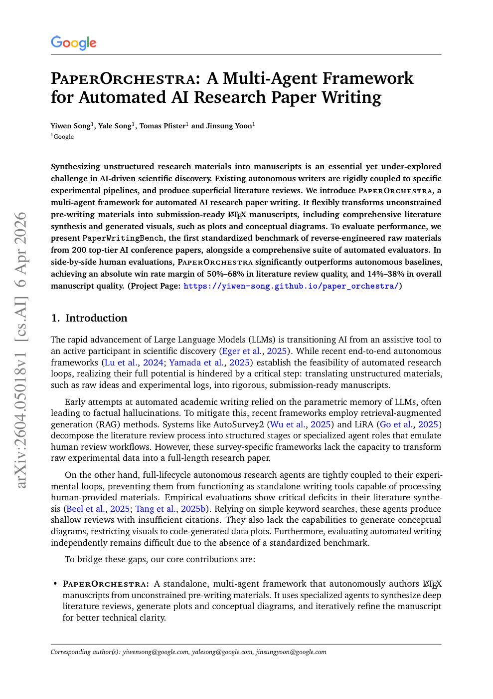

# PaperOrchestra Skill

Skills for Claude Code, Codex, Cursor, Gemini/Antigravity and other coding agents
that run the [**PaperOrchestra**](https://arxiv.org/pdf/2604.05018) multi-agent
pipeline: give it an idea, an experiment log, a LaTeX template and the venue's
guidelines, and it writes a submission-ready LaTeX paper and PDF. Your coding
agent does the model work, so **no model API key is needed**.

> Song, Y., Song, Y., Pfister, T., Yoon, J.
> *PaperOrchestra: A Multi-Agent Framework for Automated AI Research Paper Writing.*
> arXiv:2604.05018, 2026. <https://arxiv.org/pdf/2604.05018>

<p align="center">
  <a href="https://arxiv.org/pdf/2604.05018">
    
  </a>
  <br/>
  <em>Click to read the paper on arXiv</em>
</p>

This repository builds on [ar9av/paper-orchestra](https://github.com/ar9av/paper-orchestra)
(MIT) and ports Google's released code,
[google-research/paper-orchestra](https://github.com/google-research/paper-orchestra)
(Apache-2.0). See [Credits](#credits). It is not an official Google product.

## Install

You need Python 3.9 or later and a LaTeX distribution with `pdflatex` and
`bibtex` ([TeX Live](https://tug.org/texlive/), [MacTeX](https://tug.org/mactex/)
or [MiKTeX](https://miktex.org/) on Windows).

### Option 1: Claude Code plugin

In Claude Code:

```
/plugin install paper-orchestra --marketplace aryand1/paper-orchestra-skill
```

On Claude Code versions before 2.1.275, use the two-step form instead:

```
/plugin marketplace add aryand1/paper-orchestra-skill
/plugin install paper-orchestra@paper-orchestra-skill
```

Then install the Python packages once:

```bash
pip install pydantic requests pypdf pillow
```

### Option 2: clone and run the installer (any agent, any OS)

```bash
git clone https://github.com/aryand1/paper-orchestra-skill.git ~/paper-orchestra
cd ~/paper-orchestra
pip install -r requirements.txt
python install.py                 # Claude Code: links every skill into ~/.claude/skills
```

`install.py` uses only the Python standard library and works the same on
Windows, macOS and Linux. It links each skill folder into the agent's skill
folder: a symlink, or on Windows a directory junction, which needs no admin
rights. If linking fails, it copies the folder. Keep the cloned folder where it
is, because the skills run helper scripts from it. Its path is saved in
`~/.paperorchestra/config`.

| Command | Installs into |
|---|---|
| `python install.py` | `~/.claude/skills` (Claude Code, all projects) |
| `python install.py --project /path/to/project` | `/path/to/project/.claude/skills` (one project) |
| `python install.py --agent codex` | `~/.codex/skills` |
| `python install.py --agent agents` | `~/.agents/skills` (OpenClaw, OpenCode and other AGENTS.md agents) |
| `python install.py --agent gemini` | `~/.gemini/antigravity/skills` |
| `python install.py --agent all` | all four of the above |
| `python install.py --dest DIR` | any folder |
| `python install.py --mode copy` | copy instead of link |
| `python install.py --uninstall` | removes only what the installer put there |

On macOS and Linux, `bash setup.sh` does the same with symlinks and also asks
for the optional API keys below. Cursor, Cline and Aider read the skills
differently; see [`docs/coding-agent-integration.md`](docs/coding-agent-integration.md).

To update, run `git pull` in the cloned folder (linked installs pick up the
change at once; run `python install.py` again after a copy install), or
`/plugin update paper-orchestra` for the plugin.

### Check the install

With a clone (option 2):

```bash
python ~/paper-orchestra/skills/paper-orchestra/scripts/po.py --help
pdflatex --version && bibtex --version
```

In Claude Code, the skills appear in `/skills` (or under the plugin in
`/plugin`).

## Use

```bash
# 1. scaffold a workspace in your project
python ~/paper-orchestra/skills/paper-orchestra/scripts/init_workspace.py --out workspace/

# 2. put your inputs in workspace/inputs/:
#    idea.md, experimental_log.md, template.tex (+ its .sty/.cls/.bst files),
#    conference_guidelines.md, and optionally figures/ with figures/info.json
```

3. Ask your coding agent:

   > Run the paper-orchestra pipeline on ./workspace

   The agent runs `po.py advance`, answers each model call it hands out in a
   fresh sub-agent, and repeats until the paper is at
   `workspace/final/paper.pdf`. Say "extended mode" for the extra checks
   described below.

No inputs yet? Point the agent at a folder of notes or agent history
("Write a paper from my work in ~/my-project") and the optional
[`agent-research-aggregator`](docs/agent-research-aggregator.md) skill builds
`idea.md` and `experimental_log.md` first. A small worked example is in
[`examples/minimal/`](examples/minimal/).

Always check every claim, number and citation in the output before you submit it.

## Official mode (new in v0.4)

Google has released the official code at
[google-research/paper-orchestra](https://github.com/google-research/paper-orchestra)
(Apache-2.0). The `paper-orchestra` skill now runs a **port of that code** by
default. The pipeline logic is Google's: stage order, the 3-try retry, the
literature search and Semantic Scholar filters, the AgentReview reviewer
ensemble, the accept/revert rules and the final formatting pass. The prompts
are Google's exact strings. Wherever Google's code calls Gemini, the port
writes the exact model input to a file, and your coding agent answers it in a
fresh sub-agent. No model API key is needed.

```bash
pip install pydantic requests pypdf pillow   # + matplotlib for --use-plotting
python skills/paper-orchestra/scripts/po.py advance --workspace workspace/
# answer the pending calls it prints (see skills/shared/official-call-protocol.md), repeat
```

What still differs from a Gemini run, and why, is listed in
[`docs/official-alignment.md`](docs/official-alignment.md). The earlier
pipeline, with this pack's extra gates, is kept as opt-in **extended mode**.

## Why this exists

The paper defines a five-agent pipeline 
- Outline
- Plotting
- Literature Review
- Section Writing
- Content Refinement
  
that substantially outperforms single-agent and tree-search baselines on the `PaperWritingBench` benchmark (50–68% absolute win margin on literature review quality; 14–38% on overall quality). The paper ships the exact prompts for every agent in Appendix F.

This repo turns those prompts, schemas, halt rules, and verification pipelines into a set of **host-agent-executable skills**. There are **no API keys**, no SDK dependencies, no embedded LLM calls. Your coding agent does all LLM reasoning and web search using its own tools. In official mode the deterministic parts run as Google's ported Python code, which (like Google's code) queries the Semantic Scholar API directly; in extended mode the skills are instruction documents plus deterministic helpers.

<p align="center">

</p>

## How skills work here

Each skill is:

- `SKILL.md` — a dense instruction document the host agent reads and follows.
- `references/` — reference material: verbatim paper prompts (Appendix F), JSON
  schemas, rubrics, halt rules, example outputs.
- `scripts/` — **purely deterministic** local helpers: JSON schema validation,
  Levenshtein fuzzy matching, BibTeX formatting, dedup, LaTeX sanity checks,
  coverage gates. No network, no LLM, no API keys.

Everything else (LLM reasoning, web search, Semantic Scholar lookups, LaTeX compilation) is **delegated to the host agent** by instruction. See [`skills/paper-orchestra/references/host-integration.md`](skills/paper-orchestra/references/host-integration.md) for per-host invocation (Claude Code, Cursor, Antigravity, Cline, Aider).


## Core skills

| Skill | Paper step | # LLM calls | Role |
|---|---|---|---|
| `paper-orchestra` | orchestrator | — | Top-level driver. Coordinates the other six. |
| `outline-agent` | Step 1 | 1 | Idea + log + template + guidelines → structured outline JSON (plotting plan, lit review plan, section plan). |
| `plotting-agent` | Step 2 | ~20–30 | Execute plotting plan; render plots & conceptual diagrams; optional VLM-critique refinement loop; caption everything. |
| `literature-review-agent` | Step 3 | ~20–30 | Web-search candidates; Semantic Scholar verify (Levenshtein > 70, cutoff, dedup); draft Intro + Related Work with ≥90% citation integration. |
| `section-writing-agent` | Step 4 | 1 | One single multimodal call: draft remaining sections, build tables from experimental log, splice figures. |
| `content-refinement-agent` | Step 5 | ~5–7 | Simulated peer review; accept/revert per strict halt rules; safety constraints prevent gaming the evaluator. |
| `paper-writing-bench` | §3 | — | Reverse-engineer raw materials (Sparse/Dense idea, experimental log) from an existing paper to build benchmark cases. |
| `paper-autoraters` | App. F.3 | — | Run the paper's own autoraters: Citation F1 (P0/P1), LitReview quality (6-axis), SxS paper quality, SxS litreview quality. |

Steps 2 and 3 run in parallel (see `skills/paper-orchestra/references/pipeline.md`).

## agent-research-aggregator *(optional)*

A pre-pipeline skill that turns scattered coding-agent history (`.claude/`,
`.cursor/`, `.antigravity/`, `.openclaw/`) or any folder of research notes into
the `idea.md` and `experimental_log.md` inputs. It is skipped when both files
already exist. Phases, flags and example commands are in
[`docs/agent-research-aggregator.md`](docs/agent-research-aggregator.md).

## Optional integrations

The pipeline requires **zero API keys to run** under any host with a native
web search tool.  Two optional integrations improve throughput or coverage:

- **[Semantic Scholar API key](https://api.semanticscholar.org/)** — Phase 2
  (citation verification) uses the public unauthenticated Semantic Scholar
  endpoint by default (≤1 QPS).  A free API key raises the rate limit and
  reduces 429 back-off during large runs.  The bundled
  `scripts/s2_search.py` reads `SEMANTIC_SCHOLAR_API_KEY` from the
  environment automatically — if the variable is absent it silently falls
  back to unauthenticated mode.  The repo never commits a key.

  ```bash
  export SEMANTIC_SCHOLAR_API_KEY="your-key-here"   # https://api.semanticscholar.org/
  # verify it's picked up:
  python skills/literature-review-agent/scripts/s2_search.py --check-key
  ```

  See `skills/literature-review-agent/references/s2-api-cookbook.md` for
  endpoint details, field reference, and error-handling notes.

- **[PaperBanana](https://github.com/dwzhu-pku/PaperBanana)** (Zhu et al.,
  2026) — the figure-generation backbone used by PaperOrchestra for Step 2.
  Runs a Retriever → Planner → Stylist → Visualizer → Critic loop that
  produces publication-quality diagrams grounded in real paper examples.
  Requires **one** API key — fill at least one, you don't need both:
  - **Google (Gemini)** — free at [aistudio.google.com](https://aistudio.google.com/)
  - **OpenRouter** — at [openrouter.ai](https://openrouter.ai/) (preferred if both are set)

  ```bash
  git clone https://github.com/dwzhu-pku/PaperBanana
  cd PaperBanana
  pip install -r requirements.txt
  cp configs/model_config.template.yaml configs/model_config.yaml
  # open model_config.yaml — paste your Gemini key into api_keys.google_api_key
  #                        OR your OpenRouter key into api_keys.openrouter_api_key
  export PAPERBANANA_PATH="/path/to/PaperBanana"
  ```

  That's it. Set `PAPERBANANA_PATH` and the plotting-agent uses PaperBanana
  automatically for diagram figures; falls back to matplotlib if unset.
  See `skills/plotting-agent/references/paperbanana-cookbook.md` for details.

- **[Exa](https://exa.ai)** — research-paper-focused search engine. The
  literature-review-agent can use it as a Phase 1 candidate-discovery
  backend via `skills/literature-review-agent/scripts/exa_search.py`. Set
  `EXA_API_KEY` in your environment (the repo never commits a key) and the
  helper queries Exa with `category: "research paper"`, returning 10–20
  candidates per query in the format the rest of the pipeline expects. See
  `skills/literature-review-agent/references/exa-search-cookbook.md` for
  the full recipe, query patterns, cost (~$0.007/query), and security
  notes.

  ```bash
  export EXA_API_KEY="your-key-here"   # https://dashboard.exa.ai/
  python skills/literature-review-agent/scripts/exa_search.py \
      --query "Sparse attention long context" --num-results 15
  ```

  Skip Exa entirely if your host (Claude Code, Cursor, Antigravity) already
  has a native web search tool — the agent will use that instead.

## Repo layout

```
paper-orchestra-skill/
├── README.md, LICENSE, CITATION.cff, CHANGELOG.md, requirements.txt
├── install.py               # cross-platform installer (links or copies the skills)
├── setup.sh                 # macOS/Linux installer with API-key prompts
├── .claude-plugin/          # Claude Code plugin and marketplace manifests
├── skills/                  # 9 skills + shared references
│   └── paper-orchestra/scripts/po_official/   # port of Google's code (Apache-2.0)
├── examples/                # minimal toy case + a full worked report
├── tools/official_port_diff.py
└── docs/
    ├── architecture.md                 # deep-dive on the pipeline
    ├── official-alignment.md           # what matches Google's code and what cannot
    ├── official-port.diff              # every line changed in the port
    ├── paper-fidelity.md               # design decision → paper page map
    ├── agent-research-aggregator.md    # the optional pre-pipeline skill
    └── coding-agent-integration.md     # per-host setup
```

## Fidelity to the official code and the paper

Official mode is a port of google-research/paper-orchestra@d9bae99. Every
changed file carries a notice saying what changed, and
`docs/official-port.diff` shows every changed line. Parity tests check that
the prompts and helper functions match an official checkout
(`skills/paper-orchestra/scripts/tests/test_po_official_parity.py`), and an
end-to-end test drives the full pipeline with a scripted host
(`skills/paper-orchestra/scripts/tests/test_po_official_e2e.py`). See `docs/official-alignment.md`.

Every agent prompt in `skills/*/references/prompt.md` is reproduced **verbatim** from Appendix F of arXiv:2604.05018, with a header pointing to the page number. See `docs/paper-fidelity.md` for a design-decision → paper-page map.

On top of the paper, this repo adds a few deterministic hardening scripts (orphan-citation gate, anti-leakage grep, worklog-based rollback, provenance snapshots). These are clearly marked as out-of-paper improvements in `docs/paper-fidelity.md`.

## Citation

If you use this skill pack, please cite the PaperOrchestra paper. If you use
the PaperBanana plotting backbone, cite that too:

```bibtex
@article{song2026paperorchestra,
  title={{PaperOrchestra}: A Multi-Agent Framework for Automated {AI} Research Paper Writing},
  author={Song, Yiwen and Song, Yale and Pfister, Tomas and Yoon, Jinsung},
  journal={arXiv preprint arXiv:2604.05018},
  year={2026},
  url={https://arxiv.org/abs/2604.05018}
}

@article{zhu2026paperbanana,
  title={{PaperBanana}: Automating Academic Illustration for {AI} Scientists},
  author={Zhu, Dawei and Meng, Rui and Song, Yale and Wei, Xiyu and Li, Sujian and Pfister, Tomas and Yoon, Jinsung},
  journal={arXiv preprint arXiv:2601.23265},
  year={2026},
  url={https://arxiv.org/abs/2601.23265}
}
```


```
It would have been fun if the repo wrote the paper.

```

## Credits

- **The method and prompts:** Yiwen Song, Yale Song, Tomas Pfister and Jinsung
  Yoon, *PaperOrchestra* (arXiv:2604.05018), Google Cloud AI Research.
- **The official code:** [google-research/paper-orchestra](https://github.com/google-research/paper-orchestra),
  Copyright 2026 Google LLC, Apache-2.0. The port in
  `skills/paper-orchestra/scripts/po_official/` is modified as stated in each
  file and in `docs/official-port.diff`.
- **The original skill pack (v0.1 to v0.3):** [ar9av/paper-orchestra](https://github.com/ar9av/paper-orchestra)
  and its contributors, MIT.
- **Section templates** adapted from [Master-cai/Research-Paper-Writing-Skills](https://github.com/Master-cai/Research-Paper-Writing-Skills) (MIT).

## License

MIT, see [`LICENSE`](LICENSE): free to use, copy, modify and redistribute,
including commercially, as long as the copyright notice is kept. The port of
Google's code in `skills/paper-orchestra/scripts/po_official/` stays under
Apache-2.0 (Copyright 2026 Google LLC); see its `LICENSE-APACHE-2.0` and
`NOTICE`. The verbatim paper prompts are excerpts from arXiv:2604.05018, as
noted in `LICENSE`.
